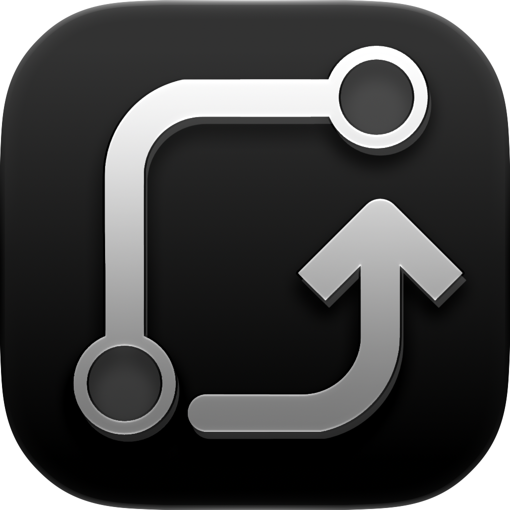
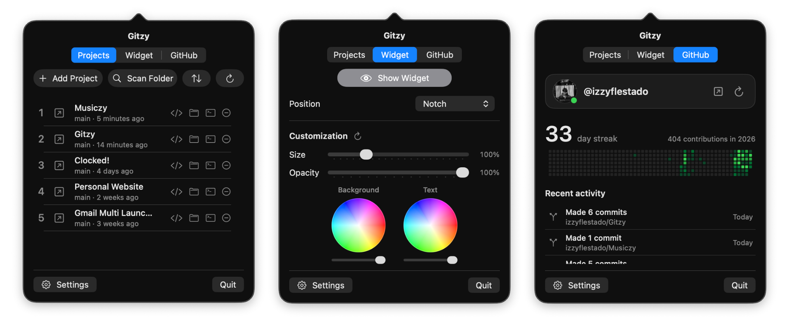
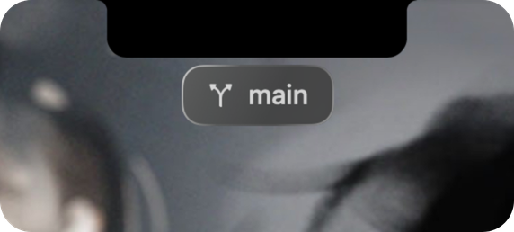

  

<h1 align="center">Gitzy</h1>

 

A small macOS menu bar app. Your git projects, your GitHub profile and a branch widget, all in one place.

Needs macOS 26 or newer. Built with Xcode 27.1.

## Preview

  

## What it does

**Projects tab**
- Add a folder, or scan a folder and it finds every repo inside
- Shows the branch of each project
- Sort by custom (drag them), name, recently added or last commit
- Each row opens the project in Finder, Terminal, your IDE or its GitHub page

**Widget tab**
- A small floating widget with the branch of the repo open in Xcode or VS Code
- Pick where it sits, its colors and its size
- App-Based Widget Visibility (in Settings): pick apps that show or hide the widget while they're on screen

**GitHub tab**
- Your @username, streak and the 12 month graph
- Recent activity under the graph: commits, pull requests, issues, reviews, new repos. Shows 5, scrolls, has Load more. Click one to open it
- A dot on your picture:
  - grey: nothing today
  - orange: commits on this Mac but not on your graph yet (maybe didn't push)
  - green: already on your graph

  Hover it for today's numbers

**Shortcuts**

They work in every app. Change them in Settings.

| Keys | Does |
| --- | --- |
| ⌥⇧[ | Open the current project in Finder |
| ⌥⇧] | Open the current project in Terminal |
| ⌥⇧\ | Open the current project in your IDE |
| ⌥⇧Return | Open or close the Gitzy menu |
| ⌥⇧\` | Open the current project's GitHub repo in the browser |
| ⌥⇧(1-10) | Open the GitHub repo of the corresponding project in your list (follows the sort) |

"Current project" is the repo open in Xcode or VS Code. It has to be saved in Gitzy.

## Setup

1. Open the project in Xcode and run it. No Apple Developer account needed. Want your own signing? See `Local.xcconfig.example`.
2. Make a classic GitHub token with only `read:user` at github.com/settings/tokens.
3. Click the Gitzy icon in the menu bar, then press Settings (the gear at the bottom). Under GitHub account, paste your token and press Connect.
4. macOS will ask to let Gitzy control Xcode, VS Code, Finder and Terminal. Say yes. That's how it knows what's open. You can change it in System Settings, Privacy & Security, Automation.

## Privacy

- It only talks to `api.github.com` (with your token) and GitHub's profile picture server (never with the token)
- The token is one file, `~/Library/Application Support/Gitzy/github-token`. Only your user can read it. It's never logged
- Recent activity asks for the same public info as your profile page. No commit messages, no code
- Git stuff is read straight from the files. No git process, nothing is written to your repos
- App-Based Widget Visibility only looks at which windows are on screen and where. No titles, no contents, no screen recording permission
- The dot reads this Mac's git logs for today's commits, only in projects that have a GitHub remote

## Heads up

- **The orange dot can be wrong.** GitHub only counts commits on the default branch (usually `main`) that use an email linked to your GitHub account. A commit on another branch, or with a different email, stays orange even after you push
- **The dot and the graph aren't live.** They update when you open the Gitzy menu, when you press refresh, and on the timer you pick in Settings (15, 30, 60 min or manual only). So after you push, the dot can stay orange until the next update
- **Only Xcode and VS Code.** The widget and the "current project" shortcuts can't see other editors

## Tests

Cmd-U in Xcode.
